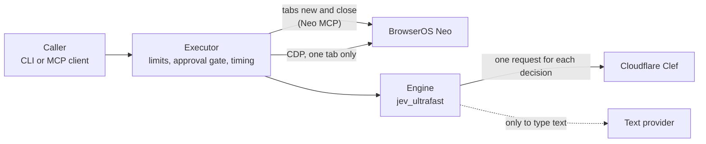
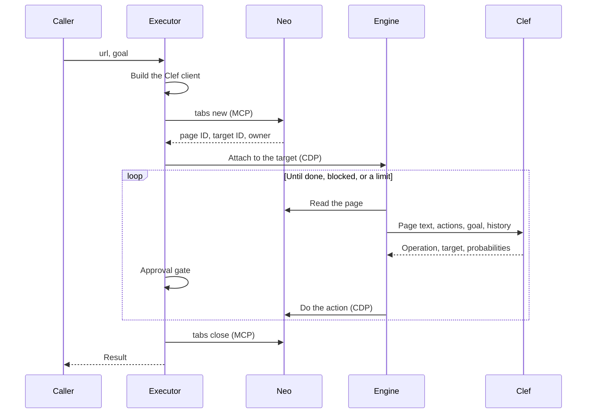

# Architecture

This document explains the parts of clef-browse-fast and how they work together.

## Overview

The solid lines are used in every task. The dotted line is used only when Clef chooses to type text.

## The parts

| Part | Location | Job |
| --- | --- | --- |
| Command line | `src/clef_browse/cli.py` | Reads the arguments and prints the result. |
| MCP server | `src/clef_browse/mcp_server.py` | Exposes the tool `browser_task` over stdio. |
| Executor | `src/clef_browse/executor.py` | Runs one task. Enforces the limits and the approval gate. Closes the tab. |
| Neo adapter | `src/clef_browse/neo.py` | Opens and closes tabs through the Neo MCP. Holds the risk terms. |
| CDP client | `src/clef_browse/cdp.py` | Sends CDP commands to Neo over one websocket. |
| Clef client | `src/clef_browse/clef.py` | Builds the Clef request, sends it, and checks the answer. |
| Engine | `src/jev_ultrafast/` | Reads the page, builds the list of actions, and does the chosen action. |

## One task, step by step

1. The executor builds the Clef client first. If the credentials are missing, the task ends before it opens a tab.
2. The executor opens a tab through the Neo MCP. Neo records the tab as owned by this session.
3. The executor reads the owner and the target ID of the new tab. If it cannot read them, it closes the tab.
4. The engine attaches to that one target over CDP.
5. In each step, the engine reads the page and builds a list of actions that the page offers.
6. The engine sends the page text, the list, the goal, and the last 10 actions to Clef.
7. Clef returns an operation and a target. The engine accepts only an operation or an index from the offered list.
8. The approval gate checks the chosen action. A risky action stops the task.
9. The engine does the action and reads the page again.
10. When the task ends, the executor closes the tab. This also happens after an error or a limit.

## Decisions and their reasons

### The program has its own CDP client

The first design used the `browser-harness` package. That package always created or attached its own tab. It also left
background processes after a failed test. The small client in `cdp.py` attaches only to the target that the executor
names. It has no background process.

### Tabs open through the Neo MCP

Neo records a tab that the MCP opens as `mine`. A tab that a raw CDP command opens shows as the user's tab. The
adapter reads the owner before it closes a tab. It refuses to close a tab that this session does not own.

### The model chooses from a list

The engine builds a list of actions from the page. Clef answers with an operation name and an index from that
list. The code does the action. The model output is never JavaScript, a selector, or a coordinate.

### Clef returns probabilities

Clef answers each question with a probability for every option. The engine uses the option with the highest
probability. The `confidence` value is also in the engine record, but the executor does not use it.

### Only one model is supported

The program accepts only `clef`. The smaller model `clef-flash` made a wrong decision in a test and the same
wrong decision repeated. See [Measured results](benchmarks.md#why-clef-flash-is-not-supported).

### A browser change is never retried

Clef and text-provider requests have no side effects. The program retries them. A click or a key press can have
side effects. The program never repeats one. If a page changes during an action, the engine reads the page again.

## Concurrency

Each task has its own MCP session, its own tab, and its own CDP session. All CDP calls share one websocket and are
serialized. Each task holds its own lock for every change to the browser. The Clef client is shared in one process.
The authors ran two tasks at the same time. Both ended with `done`.

## The engine

The folder `src/jev_ultrafast/` is a copy of `browser-use/jev-ultrafast` with changes. Four changes matter:

- The upstream hosted decision endpoint and its web UI are removed.
- The engine takes the browser and the decision function as arguments.
- The browser class attaches to an existing target. It never creates or closes a target.
- `close()` only detaches the session.

The full list is in `src/jev_ultrafast/PATCHES.md`. The upstream commit is in `src/jev_ultrafast/UPSTREAM_SHA`.
Keep local changes to this folder small. Put new code in `src/clef_browse/`.

## Data flow and privacy

The following data leaves your computer:

- To Cloudflare: the page address and title, the visible text of the page, and the labels and values of the offered
  elements. The values of form fields are included. It also gets your goal and the last 10 actions.
- To the text provider: the goal, the label, role, and value of the field, and the page title. It also gets the first
  6,000 characters of the page text and the last 6 actions. This happens only when a task types text.

The data goes to the services that you configure. Read [Safety](safety.md) before you use a signed-in page.
